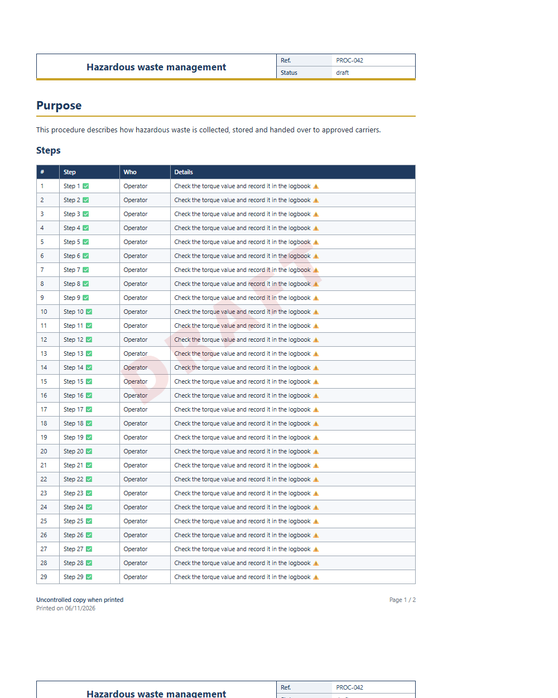

# JmiXIII — SilverBullet libraries

Libraries for [SilverBullet](https://silverbullet.md) v2.

| Library | Description |
|---|---|
| [🖨️ Paged Print](Library/JmiXIII/PagedPrint.md) | Print any page as a professional, paginated PDF: running header with logo, title and front matter fields, footer with page X / Y, status watermark, repeated table headers. Paged.js, fully client-side. |

## Installation

**Add the whole repository** (recommended — you will see every library of this repository in the Library Manager):

1. Run the command **`Library: Add Repository`**
2. Enter `github:JmiXIII/Silverbullet/Repository/JmiXIII.md`

**Or install a single library**: run **`Library: Install`** and enter its URI, e.g.

```
github:JmiXIII/Silverbullet/Library/JmiXIII/PagedPrint.md
```

Update and removal are done from the Library Manager.

---

## 🖨️ Paged Print



Print the current page as a paginated document, designed for controlled documents (quality management systems, procedures, work instructions…) but useful for any page.

* **Running header** on every page: optional logo, title, and front matter fields of your choice.
* **Running footer**: custom note (e.g. “Uncontrolled copy when printed”), print date, **Page X / Y**.
* **Watermark** from the document status (`status: draft` → “DRAFT”).
* **Tables stay in the flow** and their **header row is repeated** on every page.
* **Portrait or landscape** per document.
* **Front matter whitelist**: only listed fields are printed, the rest stays private.
* **Nothing written to the space**: works for read-only visitors, on read-only pages and offline.
* Fully configurable labels and field names (any language), colours through CSS variables.
* No server-side tool: layout by [Paged.js](https://pagedjs.org) 0.4.3 (bundled).

Usage: open a page, run **`Paged Print: Print document (PDF)`** (`Ctrl-Alt-q`), then **Print / PDF** → *Save as PDF* → untick *Headers and footers*. Recommended browser: Chrome or Edge.

Full documentation and configuration: [Library/JmiXIII/PagedPrint.md](Library/JmiXIII/PagedPrint.md).

## Repository layout

Follows the SilverBullet library conventions: library pages live under `Library/JmiXIII/` with their `name` matching their path, their assets (`files:`) at the same folder level and prefixed with the library name, and every library is listed in [Repository/JmiXIII.md](Repository/JmiXIII.md).

## License

[MIT](LICENSE). Bundled third-party code:

* [Paged.js](https://pagedjs.org) 0.4.3 — MIT License, see https://gitlab.coko.foundation/pagedjs/pagedjs (file `Library/JmiXIII/paged-print-pagedjs-0.4.3.js`, unmodified).
